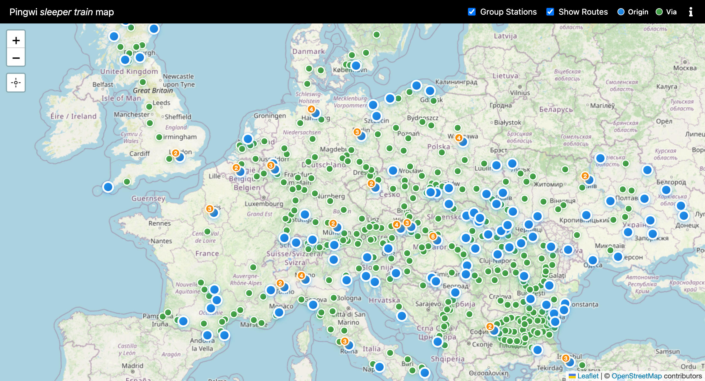

# 🚂 Sleeper Train Map



Experience the application live: [https://pingwi.com](https://pingwi.com)

## Overview

The **Sleeper Train Map** is a web application that visualizes direct night sleeper train routes across Europe. By selecting a station, users can easily see all reachable destinations via sleeper trains.

## Features

- **Interactive Map**: Displays a map with all available sleeper train routes.
- **Station Filtering**: Users can filter routes starting from a specific station to see direct connections.
- **User-Friendly Interface**: Simple and clean design for seamless navigation.

## Technologies Used

- **JavaScript**: Core programming logic.
- **SCSS/CSS**: For styling and visual appeal.
- **OpenStreetMap**: Provides the base map for station visualization.
- **Vercel**: Deploys the live application.

## Getting Started

### Prerequisites

Ensure you have the following installed:

- [Node.js](https://nodejs.org/)
- [npm](https://www.npmjs.com/) or [yarn](https://yarnpkg.com/)

### Installation

1. Clone the repository:
   ```bash
   git clone <repository-url> sleeper-train-map
   cd sleeper-train-map
   ```

2. Install dependencies:
   ```bash
   npm install
   # or
   yarn install
   ```

3. Start the development server:
   ```bash
   npm start
   # or
   yarn start
   ```

4. Open your browser and navigate to `http://localhost:3000`.

## Acknowledgements

- Special thanks to the [Back-on-Track.eu](https://github.com/Back-on-Track-eu) project for inspiration and resources.
- Thanks to: [OpenStreetMap](https://www.openstreetmap.org/) for the map data.
- Deployment powered by [Vercel](https://vercel.com/).

## License

Licensed under the [GNU Affero General Public License v3.0](LICENSE) (AGPL-3.0-only). If you run a modified version as a public service, you must offer its users the source of your version. Third-party data keeps its own licenses — see [NOTICE](NOTICE).

---
Feel free to explore and enhance the project!
